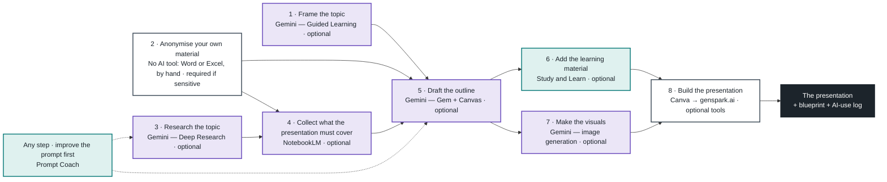

# Lesson 2 — The Two-Lane Tool Landscape
## Detailed Session Plan (Week 2, 60 minutes, online via Teams)

**Character:** debrief-first and demo-heavy — participants open the session by showing their Lesson 1 work; the facilitator then presents the sensitive-data rule and demonstrates each lane live. Nothing from Lesson 1 is re-taught; every Lesson 1 concept is referenced and pointed forward. Participants' hands-on practice is the week's assignment and Practice Week 1.

**Sources for this lesson:**
- `CONTEXT.md` — the Sensitive Lane / Daily Driver rule and the course vocabulary
- `course_roadmap.md` — the Two-Lane Tool Rule table and the Lesson 2 outline (its older assignment wording is superseded by this plan)
- `lesson_1.md` — the concepts the recap map references
- Dean's directive 1/2026 (III.26.) of the ELTE Faculty of Informatics on the use of artificial intelligence in education, research and administration — `.scratch/1_2026_sz_dekani_utasitas.pdf` (version 1.0, effective 26 March 2026; a reference, not slide content)
- Rector's directive 4/2025. (X. 28.) on the use of artificial intelligence in education at ELTE — the umbrella rule the dean's directive supplements
- `.scratch/copilot_free_to_use_tools.md` — the compiled list of Copilot Chat (Basic) agents and apps available under the institutional licence
- Gemini free-tier feature set at the time of writing (September 2026): Google One's plan comparison — https://one.google.com/intl/en/about/google-ai-plans/ — and Google's announcement of Notebooks in Gemini — https://blog.google/innovation-and-ai/products/gemini-app/notebooks-gemini-notebooklm/ ; see the re-verification flag in Segment 4

**Downstream use:** this plan is the single oracle for the Lesson 2 deck tickets and their tests, exactly as `lesson_1.md` is for the Lesson 1 deck. Each segment below is written to map onto a slide sequence.

---

## Timing Overview

| Segment | Duration | Mode |
|---------|----------|------|
| 1. Recap + assignment debrief | 15 min | Participant demos, facilitated |
| 2. The sensitive-data rule and data-protection principles | 10 min | Presentation |
| 3. Copilot Chat (Basic) in practice | 12 min | Live facilitator demo |
| 4. Gemini in depth (+ NotebookLM preview) | 15 min | Live facilitator demo |
| 5. Assignment briefing + close | 8 min | Presentation + Q&A |

Total: 60 minutes. The Session Template's hands-on block is absent by design — the 60-minute cap leaves no room for it, so hands-on work moves to the assignment and Practice Week 1 (W3).

---

## Segment 1 — Recap + Assignment Debrief (15 min)

### Part A: The recap map (≈3 min)

One slide, read at pace. Each row names a Lesson 1 concept and the Lesson 2 topic or use case it leads into — a link, never a definition. If anyone asks for the explanation, point to the Lesson 1 deck and move on.

| Lesson 1 concept | Leads into (Lesson 2) |
|------------------|-----------------------|
| The 7 Levels — Level 2 (Prompt Crafter) done in the Lesson 1 assignment | Level 3 (Power User) is today's target: persistent context via Gems (Segment 4); the assignment lays the foundation for Level 4 (Tool Orchestrator) |
| ICC prompting and the four patterns (persona, example-driven, step-by-step, critique-then-improve) | The same prompts run in both lanes — the lane decides where a prompt goes, not how it is written (Segments 3 and 4); Prompt Coach checks them (Segment 3) |
| Ask-me-first and reverse prompt | Reverse prompts become a Gem's standing instructions (Segment 4) |
| Meta-prompting | Prompt Coach is meta-prompting as a packaged agent (Segment 3) |
| The two rules stated during the Lesson 1 demo (the publish test for Gemini; verify before use) | Today the first becomes the full two-lane rule (Segment 2); the second is the directive's "critical checking of every output" (Segment 2) |
| The anonymise-or-fictional Anchor Project rule | Becomes the institutional anonymise-before-upload rule for documents (Segment 2) and the routing test in the assignment (Segment 5) |
| Context window and "more context is not better context" | Why file upload and long context (Segment 4) need curation, and why NotebookLM's source grounding exists (Segment 4 preview, Lesson 3) |

### Part B: Assignment debrief (≈12 min)

**Format:** 2–3 volunteers from the Cohort, 4 minutes each including questions, screen-shared from their own Gemini account. The facilitator keeps time visibly (a chat message at the 3-minute mark) and cuts at 4.

**What each volunteer shows** (the four assignment items from Lesson 1, in this order):
1. The Anchor Project description (five sentences) — the facilitator asks one question: "what did you anonymise or invent?"
2. One of the three ICC prompts with the one-sentence "what I'd improve" — the facilitator asks which pattern it used, if any
3. The ask-me-first result — what the model asked, whether the questions were useful
4. The meta-prompt — the generated prompt and whether it beat the naive attempt

**Capturing common problems:** the facilitator keeps a capture slide open (or a Teams chat message pinned) and writes problems down live as one line each, tagged by item (Anchor Project / ICC / ask-me-first / meta-prompt). After the last volunteer, read the list back (30 seconds) and say which ones today's session answers (routing questions → Segment 2; "the answer was wrong" → verification in Segment 2 and Prompt Coach in Segment 3; "the chat lost track" → Gems in Segment 4) and which go to Practice Week 1.

**Facilitation notes:**
- Ask for volunteers in the Teams chat before the session starts; have one backup in case a volunteer's screen-share fails
- Anyone who did not finish the assignment: no discussion now, Practice Week 1 is the venue
- The two-lane rule is not enforced yet during the debrief — if a volunteer shows sensitive content in Gemini, note it without comment and use it (anonymised) as the opening example of Segment 2

---

## Segment 2 — The Sensitive-Data Rule and Data-Protection Principles (10 min)

### The two-lane rule as a routing decision (≈3 min)

Every task is routed before any prompt is written. One question decides the lane:

**Does the task involve sensitive or IP-sensitive institutional data?**

| Answer | Lane | Tool | Covers |
|--------|------|------|--------|
| Yes | **Sensitive Lane** | Copilot Chat (Basic), institutional account | Internal administration, unsubmitted grant proposals, personnel information, strategic financial planning |
| No | **Daily Driver** | Google Gemini (free tier) | Drafting, prompting exercises, long-document analysis, general research management work |

The rule is asymmetric on purpose: the Sensitive Lane is the *only* place authorised for sensitive data, and it is *never* used for general tasks a free-tier tool does better. The lane is chosen per task, not per person and not per day.

Three worked routing examples, one line each, for the slide:
- "Summarise the partner feedback on our unsubmitted Cluster 4 proposal" → Sensitive Lane (unsubmitted proposal)
- "Explain the eligible cost categories in Horizon Europe" → Daily Driver (public knowledge)
- "Draft a workload plan for the three administrators in my unit" → Sensitive Lane (personnel information)

### AI data safety and ethical use: the framework (≈1.5 min)

The reasons behind the rule, stated once. AI data safety and ethical use mean protecting sensitive information, preventing algorithmic bias, and keeping human control over automated systems. As AI scales, balancing rapid innovation against robust risk management stops being an aspiration and becomes an operational requirement [1, 2, 3]. Responsible AI rests on four pillars, and the slide draws them as one block:

| Pillar | What it governs |
|--------|-----------------|
| **Data governance** | What may be collected, where it is allowed to travel, and who is accountable for it |
| **Algorithmic fairness** | Training and outputs actively filtered for systemic bias |
| **Transparency and explainability** | What data was used, and how a given automated decision was reached |
| **Human control** | Automated systems supplement human judgement; they never take over the responsibility |

Where this is written down for us — two documents, cited and never reproduced, carried as a compact reference strip on the same slide:

- **Umbrella rule:** Rector's directive 4/2025. (X. 28.) on the use of artificial intelligence in education at ELTE.
- **Faculty-level rule:** Dean's directive 1/2026 (III.26.) of the ELTE Faculty of Informatics — *Use of artificial intelligence in education, research and administration* — the faculty supplement to the rector's directive and to the EU AI Act (Regulation (EU) 2024/1689). Human oversight and final responsibility, transparency and documentation of AI use, no sensitive data into external AI tools without explicit permission, and critical checking of every output before use. Version 1.0, effective 26 March 2026, review expected 1 July 2026 — check for a newer version the week before delivery.

### Key pillars of data safety (≈1.5 min)

The four practices the pillars come down to in daily work:

- **Data minimisation** — collect and process only the information a clear, designated purpose actually needs [4]; the context-window lesson ("more context is not better context") and data minimisation point the same way
- **Privacy by design** — data protection built into the design of a system from the start, rather than bolted on afterwards [4]
- **Anonymisation** — masking or removing personally identifiable information (PII) safeguards people against breaches and unapproved tracking [2, 4, 5]
- **Regulatory compliance** — deployments align with [the GDPR](https://digital-strategy.ec.europa.eu/en/library/ethics-guidelines-trustworthy-ai) and the EU AI Act in Europe, and with equivalents such as the CCPA elsewhere [1]

### Ethical AI principles (≈1.5 min)

- **Fairness and non-discrimination** — training and prompting actively filter out systemic bias, or the model replicates historical inequalities as if they were findings [6, 7]
- **Transparency** — anyone affected by an automated outcome is owed clear insight into what data was tracked and how the decision was reached [7, 8]
- **Accountability** — responsibility for a system's behaviour, its audits and its performance tracking is assigned before the tool is launched [7, 9]
- **Human oversight** — the model supplements human judgement rather than displacing human responsibility [1, 9]; the tool assists, the person signs, and every output is critically checked before use

### Sources (≈30 s)

The reading list behind the three previous slides, on the slide so the room can photograph it. Not read out. Two further sources consulted while drafting were recorded video talks; the deck's no-YouTube-links rule keeps them off the slide, so the list is nine written sources.

1. European Commission — *Ethics guidelines for trustworthy AI* — https://digital-strategy.ec.europa.eu/en/library/ethics-guidelines-trustworthy-ai
2. Harvard DCE — *Ethics in AI: why it matters* — https://professional.dce.harvard.edu/blog/ethics-in-ai-why-it-matters/
3. Salesforce Trailhead — *Data ethics, privacy and practical implementation* — https://trailhead.salesforce.com/content/learn/modules/data-fundamentals-for-ai/know-data-ethics-privacy-and-practical-implementation
4. TrustCloud — *Ethical AI and data privacy practices* — https://www.trustcloud.ai/ai/boost-trust-with-powerful-ethical-ai-and-data-privacy-practices/
5. Alation — *Data ethics in AI: 6 key principles* — https://www.alation.com/blog/data-ethics-in-ai-6-key-principles-for-responsible-machine-learning/
6. SDAIA — *AI principles* — https://sdaia.gov.sa/en/SDAIA/about/Documents/ai-principles.pdf
7. Transcend — *AI ethics* — https://transcend.io/blog/ai-ethics
8. ADP — *AI and data ethics: 5 principles to consider* — https://www.adp.ca/en/resources/articles-and-insights/articles/a/ai-and-data-ethics-5-principles-to-consider.aspx
9. UNESCO — *Recommendation on the ethics of artificial intelligence* — https://www.unesco.org/en/artificial-intelligence/recommendation-ethics

### The anonymise-before-upload rule (≈1 min)

Institutional rule for documents: **a document that contains personal or sensitive information is anonymised before it is uploaded to any AI tool** — in either lane. Anonymisation means removing or replacing names, personal identifiers, unpublished amounts and partner identities so that the document can no longer be linked to a person or an unsubmitted proposal. The Lesson 1 Anchor Project rule (real-but-anonymised or fictional) was this rule in miniature; the anonymisation one-pager from Lesson 1's materials is the checklist.

### What must never enter Gemini (≈1 min)

The closing slide of the segment, as a list:
- Personal data of any kind — names with roles, contact details, evaluations, CVs, personnel matters
- Unsubmitted grant proposals and their drafts, budgets, partner lists
- Internal financial planning and strategic documents
- Unpublished research results and raw data
- Results of industrial or contract research
- Any document under a confidentiality or data-processing agreement
- Anything not anonymised that would need to be

Anything on this list goes to the Sensitive Lane, anonymised first if it is a document. If it fails the anonymisation test even there, it does not go into an AI tool at all.

---

## Segment 3 — Copilot Chat (Basic) in Practice (12 min)

Live facilitator demo in Copilot Chat (Basic) with the institutional account, in Teams. This segment stays entirely in the Sensitive Lane; the Daily Driver is not mentioned. Participants watch; they reproduce in the assignment and Practice Week 1.

### Sensitive Lane use cases (≈2 min)

One slide, four use cases, each a one-line routing example plus the prompt shape (ICC, from Lesson 1):
1. **Internal administration** — "Turn these meeting notes into a decision log and action list" (notes pasted, names replaced by roles)
2. **Unsubmitted proposals** — "Check this draft work-package description against the call's evaluation criteria and list gaps"
3. **Personnel matters** — "Draft a neutral workload-distribution note for a three-person unit from these constraints"
4. **Strategic financial planning** — "Build a three-scenario cost projection table from these assumptions"

### Limits and guardrails (≈2 min)

- **Enterprise behaviour:** prompts and responses stay within the institutional Microsoft 365 tenant, are not used to train the models, and are protected by the same terms as the institution's other Microsoft 365 data — this is why it is the Sensitive Lane
- **No SharePoint/OneDrive grounding:** Copilot Chat (Basic) does not read the institution's files by itself; what it knows about a task is what is pasted or attached into the chat — the relevant content has to be brought to it, curated (context window, Lesson 1)
- **Underperforms free-tier tools on general tasks:** shorter effective context, fewer capabilities — the reason it is never used for general work
- **Anonymise anyway:** the enterprise boundary does not remove the anonymise-before-upload rule for documents with personal data

### One use case per tool in the compiled tool list (≈8 min)

The tools come from `.scratch/copilot_free_to_use_tools.md`. Each is introduced with one use case; two are run live (marked), the rest are shown as slides with the prompt on the slide.

| Tool | Use case | Notes for the slide |
|------|----------|---------------------|
| **Adobe Acrobat** (agent in Copilot, Teams, Outlook) | Open a PDF call document shared in a Teams channel, read it in high fidelity, collect reviewer comments in one PDF instead of reconciling attachments | Free-to-use features only: high-quality viewing, central access to PDFs from Teams/OneDrive, streamlined PDF review, reviewer notifications, secure collaboration. Premium features (convert, combine, reorganise pages, compress, password) and the AI Assistant add-on are flagged as **not available** under the institutional licence |
| **Prompt Coach** (Microsoft agent) | Paste one of the participant's own ICC prompts from the Lesson 1 assignment and ask Prompt Coach to critique and improve it | **Run live.** Tie back: this is Lesson 1's meta-prompting as a packaged agent — the model as your prompt engineer, now with a coach persona built in. Save the improved prompt for the prompt library |
| **Study and Learn** (Microsoft agent) | Explain a concept from the Anchor Project's domain (e.g. "eligible costs"), then generate flashcards and a five-question quiz for a junior colleague | **Run live.** Learning outcomes: concept explanation, flashcard practice, quizzes. Requires a Microsoft 365 Education account; no Copilot licence needed. This is the tool that makes the assignment's "educational presentation" testable |
| **Canva** (Teams app) | Prototype the structure of a presentation as a multi-page Canva design, previewed and commented on inside Teams | Presentation *prototyping*: notifications, previews, collaboration inside Teams. Canva had been dropped from the Core Roster; it returns here in this narrow role only, and `CONTEXT.md` and the roadmap now record it as taught outside the roster, alongside genspark.ai |
| **genspark.ai** | Turn the approved prototype and the drafted content into the actual presentation deck | The tool for the *actual* presentation in the assignment. Outside the Microsoft tenant: only anonymised, non-sensitive content goes in — the routing rule applies to every step of a chain |

**Demo script (which use case runs live):**
1. Open Copilot Chat in Teams; show the enterprise notice (30 s)
2. Sensitive Lane use case 1 live: paste anonymised meeting notes, ICC prompt, decision log out (2 min)
3. Prompt Coach live on a participant's ICC prompt from the debrief — with their permission, or the facilitator's own (2 min)
4. Study and Learn live: concept explanation, then flashcards and a quiz (2 min)
5. Adobe Acrobat, Canva, genspark.ai: slide only, one use case each, the free-vs-premium flag on the Acrobat slide (1.5 min)

**Rule stated while demoing:** what goes into Copilot Chat is still checked — enterprise boundary or not, the directive's critical-checking and anonymisation points apply.

---

## Segment 4 — Gemini in Depth (+ NotebookLM Preview) (15 min)

Live facilitator demo in Gemini (free tier) with a personal Google account. This segment stays entirely in the Daily Driver; the Sensitive Lane tool is not mentioned. Everything demonstrated uses anonymised or fictional Anchor Project material.

**Availability flag:** Gemini's free tier changes month to month. Every capability below is re-verified in the facilitator's own account the week before delivery, and the slides say "free tier at the time of writing (September 2026)". Anything that has moved behind a paid plan is shown as a slide, not demoed, and marked as such.

### Free-tier capabilities beyond the Sensitive Lane tool (≈10 min)

Each capability with one use case and whether it is demoed live:

| Capability | Use case | Demo |
|------------|----------|------|
| **File and image upload** | Upload an anonymised call document (PDF) and a screenshot of a budget table; ask for the eligibility checklist and a reading of the table | **Live** — the first thing the Sensitive Lane tool cannot do this well |
| **Long context** | Paste a long guideline document and ask for a structured summary; point at the limits (the free tier's window is smaller than the paid plans') and at Lesson 1's curation rule | **Live**, short — one document |
| **Gems — persistent context** | Create a Gem "Anchor Project assistant": standing instructions (the reverse prompt from Lesson 1), the project description, up to the free tier's reference-file limit. Every future chat starts already knowing the domain | **Live** — this is the Level 3 move: dedicated workspaces that already know your domain |
| **Deep Research** | Ask for a researched briefing on a funding landscape question with sources; the free tier has a monthly report cap, so the demo shows a report prepared beforehand and the prompt that produced it | Slide + prepared result |
| **Canvas** | Draft the outline of an educational presentation in Canvas, then iterate section by section; export the structured draft | **Live** — structured outputs and drafts |
| **Google Workspace hooks** | Drive/Docs/Gmail connections; on the free tier these are limited or absent at the time of writing — shown as the paid-plan boundary | Slide only |
| **Image generation and editing** | Generate a diagram-style illustration for the presentation from a text description | Slide + prepared result |
| **Gemini Live and mobile** | Voice conversation for rehearsing a presentation; mobile app parity | Mentioned |
| **Guided Learning mode** | Step-by-step tutoring on a concept instead of a direct answer — the Daily Driver's tutoring mode for learning-outcome design | Slide only |
| **Saved info / personalisation** | Standing facts about the participant that every chat sees — the lightweight version of a Gem | Mentioned |

### NotebookLM at use-case level (≈4 min)

NotebookLM is the Lesson 3 tool; today only three use cases, no walkthrough. Note for the slide: in 2026 Google folded NotebookLM into the Gemini product family (the "Notebooks in Gemini" integration, with the NotebookLM product renamed "Gemini Notebook" in mid-2026); the notebook-to-Gemini link appeared on paid plans first. The facilitator re-verifies which of the three use cases the free tier supports the week before delivery, and marks any paid-only step on the slide.

1. **YouTube link turned into a textual source** — a public video with captions becomes a text source the notebook can cite; no YouTube link appears in the deck, the use case is described
2. **Several documents aggregated in one notebook** — call document, guidelines, FAQ, and the participant's own notes in one source-grounded notebook; answers cite the sources (this is the answer to "more context is not better context")
3. **Notebooks imported into Gemini as project folders** — a notebook linked into a Gemini chat as the project's context, so the Anchor Project's sources travel with the conversation

### Demo script

1. Upload demo: PDF + image, ICC prompt (2.5 min)
2. Long-context demo: one long document, summary (1.5 min)
3. Gem creation: name, instructions, reference files, first chat (3 min)
4. Canvas: presentation outline, one iteration (2 min)
5. Deep Research, Workspace hooks, image generation, Guided Learning, saved info: slides with prepared results (1.5 min)
6. NotebookLM: three use-case slides (4 min)

**Rule stated while demoing:** everything on screen is anonymised or fictional; the "what must never enter Gemini" list from Segment 2 stays on the second monitor.

---

## Segment 5 — Assignment Briefing + Close (8 min)

The assignment *is* a chain, so the briefing is the chain, not a description of one. The blueprint is authored here in full and the slides render it: a roadmap of the whole route, then the eight steps in three screenfuls. Nobody has to invent an orchestration from the sentence "produce a blueprint"; they run this route on a topic of their own and write down what they skipped or changed, and why.

Two rules shape the route. First, the only required step is the one that handles sensitive data (step 2), and it is required only when the participant's own material contains sensitive data; every other step is optional, so a participant whose topic does not need a step skips it and says so. Second, every step names where its input comes from and where its output goes, so the chain reads as a chain: nothing is produced without a later step that consumes it.

### Assignment slide (as it will appear)

**Assignment: your first workflow orchestration**

Chain the tools the course has introduced so far into one multi-step workflow orchestration, and run it end to end on a topic you pick.

1. **Deliverable:** a presentation on a hand-picked topic, designed for educational purposes and intended to facilitate learning outcomes.
2. **Blueprint:** the roadmap on the next four slides, adapted to your topic. For each step you run: the tool, the input, the output and how you ran it. For each step you skip or change: one line saying why.
3. **Routing:** every step that touches sensitive data is routed to the correct lane; documents are anonymised before upload; the blueprint states the lane per step.

**Outcome:** Level 3 achieved — you work in a persistent, domain-aware workspace; foundation for Level 4 established — the right tool per step, chained.

### The roadmap (≈2 min)

Eight steps in three phases. Prepare (steps 1–2): fix the topic and make your own material safe to upload. Gather (steps 3–4): fill what your material does not cover and collect what the presentation must say. Produce (steps 5–8): outline, learning material, visuals, deck. Prompt Coach is not a step: it is the helper you run any prompt through before you use it, at whichever step you are on.

The diagram is part of the deliverable, not decoration: a chain that cannot be drawn has not been thought through. The Mermaid source above is the starting point. Fork it, redraw it for your own chain, and hand it in with the step table.

**Which steps are required:** only step 2, and only when your own material contains sensitive data. If you use no material of your own, or only public material, skip it and say so. Every other step is optional: skip the ones your topic does not need, and write one line in the blueprint saying why.

**The gate that is not a step:** check every output before it becomes the next step's input, and log the tool, the date and what it was used for. The dean's directive's critical-checking and transparency points are per step, not per project, and that log is the AI-use declaration on the presentation's last slide.

**Why Adobe Acrobat is not in the chain:** the Acrobat app in Teams needs system-administrator approval, which participants cannot obtain, and the course has no institutional PDFs in Teams to review. Anonymisation is manual work in Word or Excel, and it happens before any file reaches any AI tool, so no AI tool can do it.

### The blueprint, step by step

| # | Step | Tool | Lane | Required | In | Out |
|---|------|------|------|----------|----|-----|
| 1 | Frame the topic | Gemini · Guided Learning | Daily Driver | Optional | A topic idea, your audience, the length of the presentation | A topic statement and three learning outcomes → steps 5, 6, 7 |
| 2 | Anonymise your own material | No AI tool · Word or Excel, by hand | None (manual) | Required if the material contains sensitive data | Your own documents: notes, tables, call texts, reports | Files that may be uploaded anywhere → steps 4, 5 |
| 3 | Research the topic | Gemini · Deep Research | Daily Driver | Optional | One research question: what your material does not cover, or the topic itself | A cited briefing, saved as a file → step 4 |
| 4 | Collect what the presentation must cover | NotebookLM | Daily Driver | Optional | The files from step 2 and the briefing from step 3 | A coverage list, each point with its source → step 5 |
| 5 | Draft the outline | Gemini · a Gem with file upload, long context and Canvas | Daily Driver | Optional | The outcomes from step 1, the coverage list from step 4, the files from step 2 | A section-by-section outline → steps 6, 7, 8 |
| 6 | Add the learning material | Study and Learn · Copilot Chat (Basic) | Sensitive Lane | Optional | The outline from step 5, one learning outcome at a time | An explanation, a flashcard set and a quiz per outcome → step 8 |
| 7 | Make the visuals | Gemini · image generation | Daily Driver | Optional | One section of the outline from step 5 and a one-sentence description of its diagram | One image per section that needs one → step 8 |
| 8 | Build the presentation | Canva (Teams app) → genspark.ai | Outside both lanes | Optional tools, required output | The outline (5), the learning material (6), the visuals (7) | The finished presentation and a short video excerpt: the deliverable |

**Step 1 — Frame the topic.** *How:* open Guided Learning and give it the ask-me-first prompt from Lesson 1: before you answer, ask me what you need to know. Answer its questions. Keep only outcomes you can observe: "decide whether a cost is eligible and say why" is one, "understand eligible costs" is not. Stop at three. *Output goes to:* step 5 (the outline), step 6 (the learning material) and step 7 (the visuals) are all built against these three outcomes.

**Step 2 — Anonymise your own material.** *How:* work on a copy. Go through each file by hand in Word or Excel with the Lesson 1 anonymisation checklist: replace names, IDs, amounts, dates and anything that identifies a person, a project or a partner. Record per file: anonymised, public, or not usable. No AI tool is involved, because nothing may reach an AI tool before this step is done. *Output goes to:* step 4 (the notebook) and step 5 (the Gem's reference files). If you use no material of your own, skip this step and say so in the blueprint.

**Step 3 — Research the topic.** *How:* write one research question, not five. If you have your own material, ask what it does not cover; if not, ask about the topic itself. Ask for a source per claim. Open at least three of the sources and check they say what the report says. The free tier limits reports per month, so write the question before you spend one. *Output goes to:* step 4, as one more file in the notebook.

**Step 4 — Collect what the presentation must cover.** *How:* one notebook per topic. Add the files from step 2 and the briefing from step 3, then ask: what does a newcomer need to know about this, and which source says it? Drop any answer without a citation. If NotebookLM is not available to you this fortnight, upload the same files to Gemini, ask the same question, and say so in your blueprint. *Output goes to:* step 5, as the list of what the outline has to contain.

**Step 5 — Draft the outline.** *How:* build a Gem first: the topic statement and the three outcomes as its instructions, the files from step 2 as its reference files; long context means it reads all of them. Ask for an outline in Canvas, then edit one section at a time instead of regenerating the whole thing. Tag each section with the outcome it serves and cut any section that serves none. *Output goes to:* step 6 (learning material), step 7 (visuals) and step 8 (the deck).

**Step 6 — Add the learning material.** *How:* one outcome at a time. Ask for an explanation and read it as a learner would; then flashcards on the key terms; then a five-question quiz. Drop any question that can be answered without having seen the presentation. Needs a Microsoft 365 Education account; no Copilot licence. *Output goes to:* step 8, as its own section of the deck.

**Step 7 — Make the visuals.** *How:* describe the relationship you want shown, not the picture: "three stages, each feeding the next, the middle one highlighted". Read the labels in the result; text inside generated images is often wrong, and the fix is to regenerate, not to patch. Not every section needs an image. *Output goes to:* step 8.

**Step 8 — Build the presentation.** *How:* prototype the slide structure in Canva and let a colleague comment on it before any content goes in. Cut a 20–40 second video excerpt in Canva for the opening. Then give the outline, the learning material and the visuals to genspark.ai and build the deck. Rehearse once out loud. Put the AI-use log on the last slide. Both tools sit outside the institutional tenant: only content that passed step 2 goes into them. *Output goes to:* nowhere. This is the deliverable.

**Prompt Coach, at any step.** Before you run a prompt in steps 3 to 6, paste it into Prompt Coach with one sentence about the job it has to do, ask for a critique and an improved version, and keep the improved one only if you can say what changed. Copilot Chat (Basic), Sensitive Lane; nothing but the prompt goes in.

### Effort and where the work is shown (≈2 min)

- Expect 3–4 hours across the two weeks; the blueprint first, then the presentation
- Eight steps is the recommended route, not a quota: only step 2 is required, and only when your material contains sensitive data; skip any other step and say why
- The tools to chain from are the steps' tools — Gemini with Guided Learning, Deep Research, a Gem, file upload, long context, Canvas and image generation; NotebookLM if the free tier supports it; Copilot Chat (Basic) with Study and Learn, and Prompt Coach at any step; Canva for the prototype and the excerpt, genspark.ai for the deck
- Done looks like a blueprint that says what went in, what came out and why any step was skipped, a presentation that teaches something, and an AI-use log
- Show the work at Practice Week 1's drop-in (W3) for troubleshooting, and at the Lesson 3 debrief (W4) — 2–3 volunteers present blueprint and presentation

### Close (≈1 min)

- **Practice Week 1 (W3):** optional facilitated drop-in, no new material; bring the blueprint, the lane questions, and any Gemini free-tier surprises
- **Lesson 3 (W4):** NotebookLM properly, Perplexity for cited research, and the Wiki Sandbox — the first piece of your KM System

---

## Materials to Prepare (Facilitator)

- Slide deck per the segment structure above, in a design distinct from Lesson 1
- Volunteer list and one backup, collected in Teams chat before the session; a capture slide or pinned chat message for the debrief
- Anonymised meeting notes and an anonymised call document (PDF) plus a budget-table screenshot for the two demo segments; all fictional or anonymised
- Prompt Coach and Study and Learn tested in Copilot Chat with the institutional account the day before; the Adobe Acrobat free-vs-premium boundary checked
- The Gemini free-tier feature check the week before delivery: upload limits, Gem reference-file limit, Deep Research monthly cap, Canvas, Workspace hooks, Guided Learning, and which of the three NotebookLM use cases the free tier supports; prepared Deep Research report and generated image as fallback results
- The dean's directive and the rector's directive checked for newer versions; the Lesson 1 anonymisation one-pager reused as the anonymise-before-upload checklist
- Assignment slide text as above, ready to paste into Teams chat after the session
